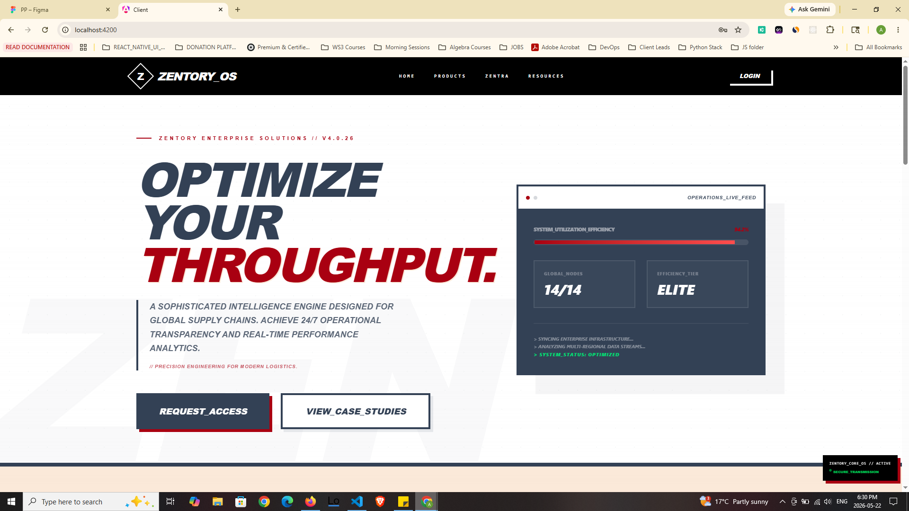
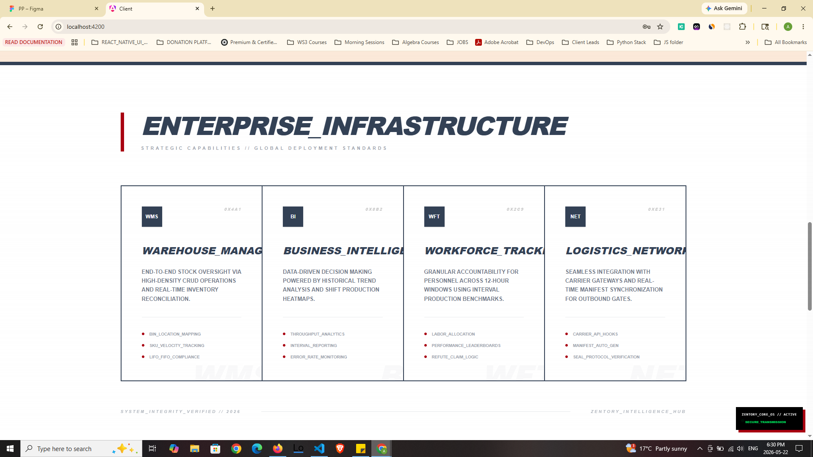
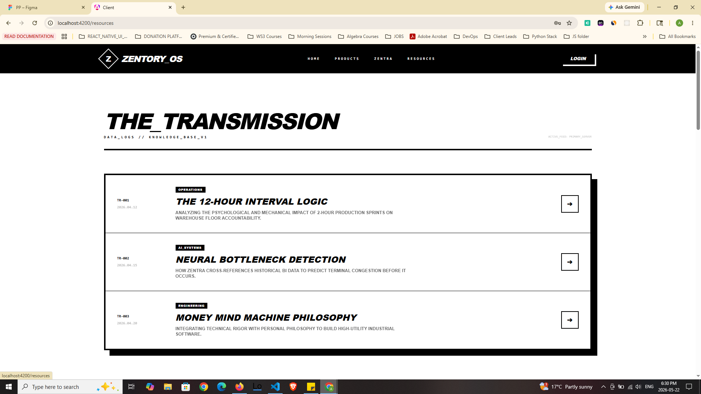
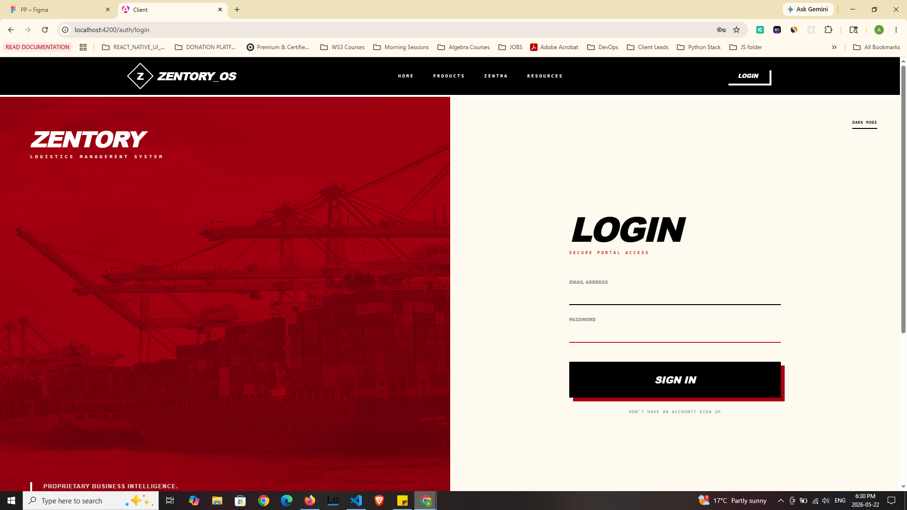
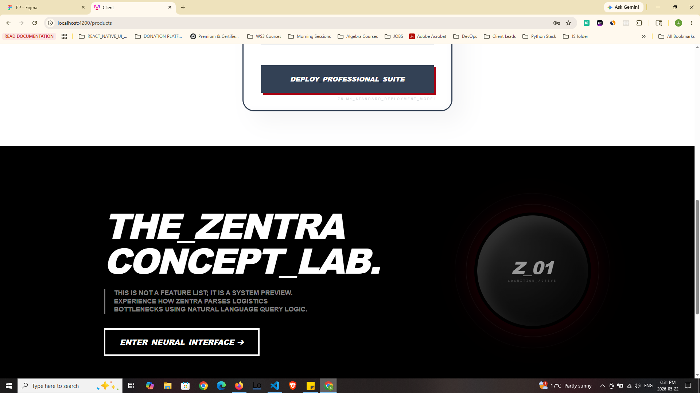
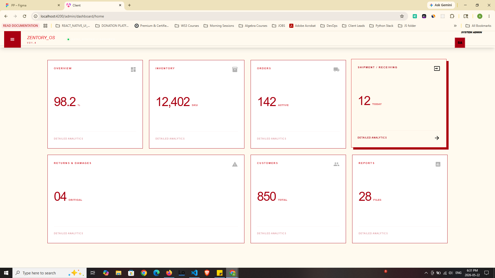
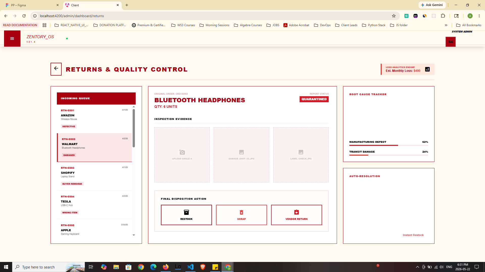
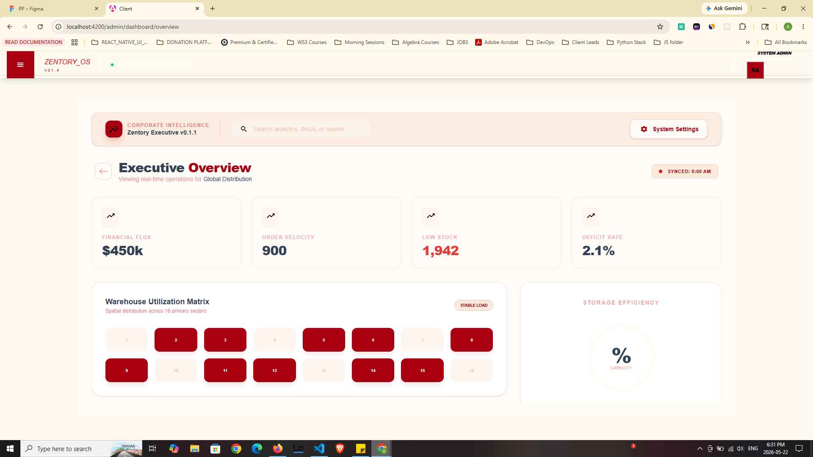
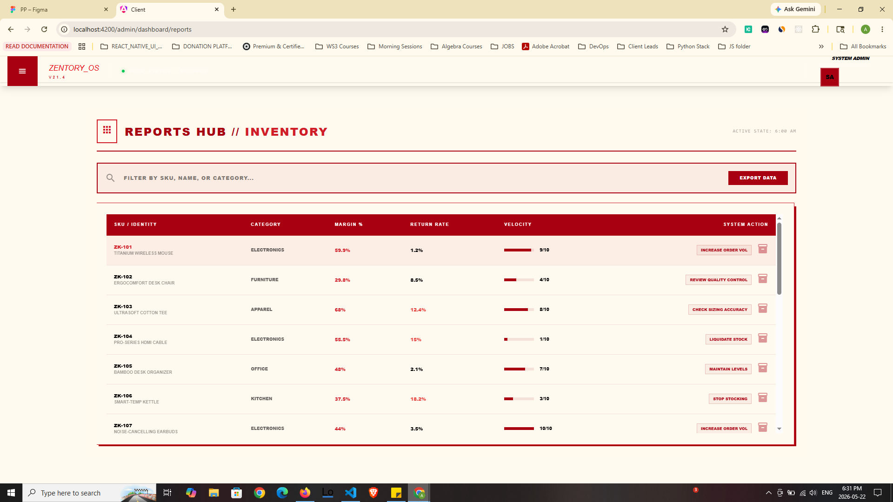
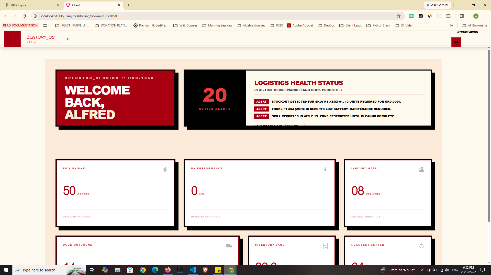

# Zentory_OS // Enterprise Intelligence Suite

**Strategic Logistics Management & Real-Time Operational Analytics**

---

## 🛰️ Project Overview
**Zentory_OS** is a high-tier enterprise software ecosystem designed for global supply chains. Developed with a focus on **Operational Excellence** and **Strategic Intelligence**, the platform provides a unified interface for complex warehouse environments. 

Integrating the **Money Mind Machine** philosophy, the system merges technical rigor with high-utility industrial logic to optimize every 12-hour production window.

---

## ⚡ Core System Architecture

### 1. Unified Operations Terminal
The primary landing interface focuses on **Throughput Optimization**. It features a live telemetry pulse and global node monitoring to ensure 24/7 transparency across all regional logistics tiers.

### 2. Strategic Infrastructure & Feature Suite
The system is built on modular deployment standards, allowing for seamless integration of WMS, BI, and Workforce Tracking modules.

### 3. Knowledge Base // The Transmission
A centralized repository for operational data logs and engineering protocols, ensuring all personnel are aligned with the latest system telemetry.

### 4. Secure Authentication Gateway
High-security portal access featuring a sleek, industrial-grade login interface that reinforces the proprietary nature of the business intelligence.

### 5. Zentra Concept Lab
An advanced neural interface preview that allows stakeholders to experience how the system parses logistics bottlenecks using natural language query logic.

### 6. Administrative Command Center
The high-level oversight dashboard for system admins, providing a 360-degree view of inventory, active orders, and shipment health.

### 7. Quality Control & Recovery Center
A dedicated module for handling reverse logistics and technical inspections.
* **Master-Detail Queue**: Seamless navigation through incoming returns.
* **Disposition Engine**: Standardized protocols for restock, scrap, or vendor return actions.

### 8. Executive Overview & Utilization Matrix
A sophisticated data engine that parses complex warehouse metrics into executive-level insights, featuring spatial distribution heatmaps for primary sectors.

### 9. Inventory Reports Hub
High-density SKU analysis featuring margin percentages, return rates, and stock velocity indicators for data-driven procurement.

### 10. Operator Session // User Dashboard
The ground-level interface for personnel, featuring real-time logistics health status, active alerts, and performance telemetry.

---

## 🎨 Design Philosophy: "Enterprise WHAM"
The visual identity utilizes a high-contrast, professional aesthetic defined by:
* **Primary Palette**: Deep Navy (`#334155`), Zentory Red (`#A90011`), and Foundation Tan (`#FBE9D9`).
* **Typography**: Bold, italicized headers paired with monospaced technical telemetry for an authoritative, "Mission Control" feel.
* **Tactile UI**: Heavy offset shadows and thick borders that emphasize durability and industrial reliability.

---

## 🛠️ Technical Stack
* **Framework**: Angular 18 (Standalone Components & Signals)
* **Styling**: Tailwind CSS v4
* **Logic**: Reactive State Management with RxJS & Computed Signals
* **Data**: High-density JSON telemetry simulation for real-time testing

---

**Zentory_OS // 2026 // SYSTEM_INTEGRITY_VERIFIED**